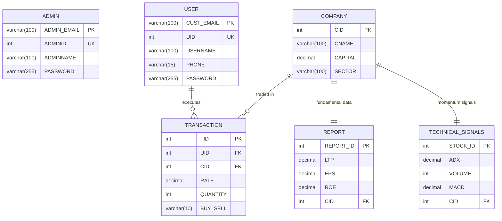

# Institutional & Retail Financial Portfolio Management System (FinManage)

[](https://www.oracle.com/java/)
[](https://tomcat.apache.org/)
[](https://www.mysql.com/)
[](https://getbootstrap.com/)
[](https://www.chartjs.org/)
[](https://sweetalert2.github.io/)

A modern, institutional-grade **Financial Portfolio Management System (FinTech Application)** designed for wealth asset management, stock analysis, automated transaction reconciliation, and real-time equity market tracking. Engineered using Java Server Pages (JSP), MySQL, and modern front-end technologies with a refined dark-navy institutional theme.

---

## 🌟 Executive Highlights

- **Executive Client Wealth Dashboard**: Real-time KPI metrics (Net Portfolio Value, Total Realized/Unrealized Gain, Asset Diversity Index), interactive Chart.js portfolio performance graph with multi-timeframe toggles (`1D`, `1W`, `1M`, `1Y`, `ALL`), sector allocation donut charts, and live order execution.
- **Administrator Command Console**: System-wide database analytics, aggregated market valuation, and centralized CRUD entity management across Users, Listed Enterprises, Fundamental Reports, Technical Signals, and Transaction Books.
- **Institutional FinTech Aesthetics**: Unified typography using **Google Fonts Poppins** (`300` through `800`) with **JetBrains Mono** for monetary figures, live market ticker tape with marquee animation, custom vector SVG enterprise emblems, and responsive layouts.
- **Enterprise Security**:
  - Secure **SHA-256 Cryptographic Password Hashing** before database persistence.
  - Email-based authentication for both Clients and Administrators (`CUST_EMAIL` and `ADMIN_EMAIL` as Primary Keys).
  - SQL injection immunity utilizing parameterized `PreparedStatement` interfaces.
- **Interactive UX & Validations**:
  - Real-time client-side JavaScript validation with high-visibility red borders (`#ef4444`) and contextual error feedback.
  - Interactive **SweetAlert2 "Are you sure?" confirmation dialogs** preceding critical actions (Sign In, Registration, Quick Trades, Entity Creation/Modifications, and System Sign-Out).

---

## 📐 Relational Database Schema & Entities

The system interfaces with MySQL (`FINANCIAL_DB`). The database schema enforces relational integrity with cascading updates and deletions.



---

## 💻 Tech Stack Architecture

- **Backend Runtime**: Java 8+ / Java 17 (JSP 2.3, Servlets 3.1)
- **Database Engine**: MySQL 8.0+ / MariaDB (`FINANCIAL_DB`)
- **Connection Driver**: MySQL Connector/J (`com.mysql.cj.jdbc.Driver`)
- **Web Application Server**: Apache Tomcat 9.0 / 10.1
- **Styling Architecture**: Custom FinTech Elite CSS (`Resources/fintech-theme.css`) with CSS custom properties
- **Typography**: Google Fonts **Poppins** (Primary UI) & **JetBrains Mono** (Metrics)
- **Data Visualization**: Chart.js v4.4
- **Modals & Dialogs**: SweetAlert2 v11
- **Icons**: Bootstrap Icons v1.11 & FontAwesome 6

---

## 📁 Project Directory Structure

```text
DBMS-PORTFOLIO-MANAGEMENT-SYSTEM/
├── Financial-Portfolio-DB.sql     # Database schema, tables, views & seed records
├── pom.xml                        # Maven dependency descriptor
├── README.md                      # Comprehensive documentation
└── src/
    └── main/
        └── webapp/
            ├── index.jsp                  # Landing page with ticker tape & market pulse
            ├── login.jsp                  # Client sign in (email & password)
            ├── register.jsp               # New client onboarding (with hashing & validation)
            ├── customer-dashboard.jsp     # Investor wealth terminal & Quick Trade
            ├── admin-login.jsp            # Superuser access portal
            ├── admin-dashboard.jsp        # Administrative command console
            ├── browse-company.jsp         # Listed equities market directory
            ├── browse-reports.jsp         # Fundamental financial reports
            ├── browse-signals.jsp         # Technical quantitative indicators
            ├── browse-transaction.jsp     # Transaction audit trail & order book
            ├── manage-companies.jsp       # Admin company CRUD manager
            ├── manage-reports.jsp         # Admin fundamental report CRUD manager
            ├── manage-signals.jsp         # Admin technical signals CRUD manager
            ├── manage-transactions.jsp    # Admin order book CRUD manager
            ├── manage-users.jsp           # Admin client registry CRUD manager
            └── Resources/
                ├── fintech-theme.css      # Core FinTech Design System & Poppins typography
                ├── fintech-charts.js      # Chart.js engine, live calculation & validation
                ├── Land-Image.jpg         # Hero visual asset
                └── stocks/                # Vector SVG corporate emblems
                    ├── airtel.svg
                    ├── generic.svg
                    ├── hdfc.svg
                    ├── icici.svg
                    ├── infosys.svg
                    ├── lt.svg
                    ├── reliance.svg
                    ├── sbi.svg
                    ├── tatamotors.svg
                    ├── tcs.svg
                    └── wipro.svg
```

---

## 🚀 Setup & Execution Guide

### 1. Database Setup
1. Launch your MySQL Server (via MySQL Workbench, Command Line, or XAMPP).
2. Execute the initialization script:
   ```sql
   SOURCE Financial-Portfolio-DB.sql;
   ```
   *This automatically creates `FINANCIAL_DB`, configures all tables, primary keys, foreign key constraints, and seeds all 10 records per entity.*

3. Verify database configuration credentials in your deployment if modified:
   - **JDBC URL**: `jdbc:mysql://localhost:3306/FINANCIAL_DB`
   - **User**: `root`
   - **Password**: `trickortreat`

### 2. Application Deployment

#### Via Eclipse IDE / Spring Tool Suite:
1. Open Eclipse and choose **File > Import > Existing Projects into Workspace** (or **Existing Maven Projects**).
2. Right-click the project folder and select **Configure > Convert to Dynamic Web Project** (if not already detected).
3. Target runtime: **Apache Tomcat v9.0** (or compatible).
4. Right-click the project > **Run As > Run on Server**.
5. Navigate to: `http://localhost:8080/DBMS-PORTFOLIO-MANAGEMENT-SYSTEM/` (or configured context path).

#### Via Standalone Apache Tomcat:
1. Package the web application into a `.war` file (or deploy the `webapp` folder).
2. Copy into `$TOMCAT_HOME/webapps/portfolio.war`.
3. Start Tomcat using `bin/startup.bat` (Windows) or `bin/startup.sh` (Linux/macOS).
4. Access via browser: `http://localhost:8080/portfolio/`.

---

## 🛡️ Security & Validation Highlights

- **Hashing Standard**: Passwords are never stored in plain text. Registration and login calculate standard `SHA-256` 64-character hexadecimal digests using `java.security.MessageDigest`.
- **Primary Key Constraints**: `CUST_EMAIL` is enforced as the unique Primary Key on client user profiles; `ADMIN_EMAIL` is enforced on administrative accounts.
- **Relational Integrity**: Foreign key links to `COMPANY(CID)` and `USER(UID)` use `ON DELETE CASCADE ON UPDATE CASCADE` to prevent orphaned records.
- **Form Verification**: Client forms feature instant inline JavaScript verification displaying red borders (`.is-invalid`) and alert dialogs before processing database mutations.

---

## 📄 License & Attribution

Developed for Academic Demonstration, DBMS Mini-Project Evaluation, and Portfolio Management Demonstration.
All corporate logos and ticker references are utilized under educational Fair Use guidelines.
